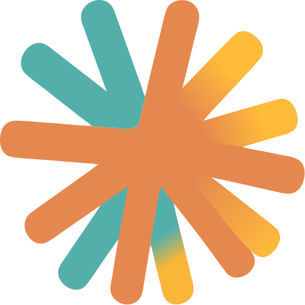
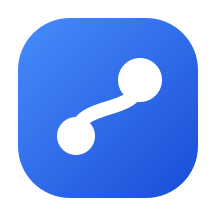
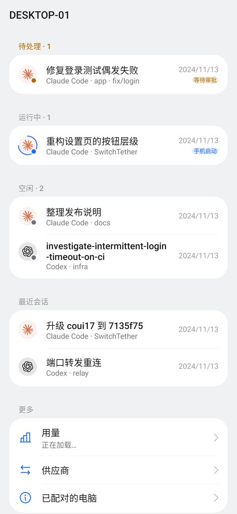
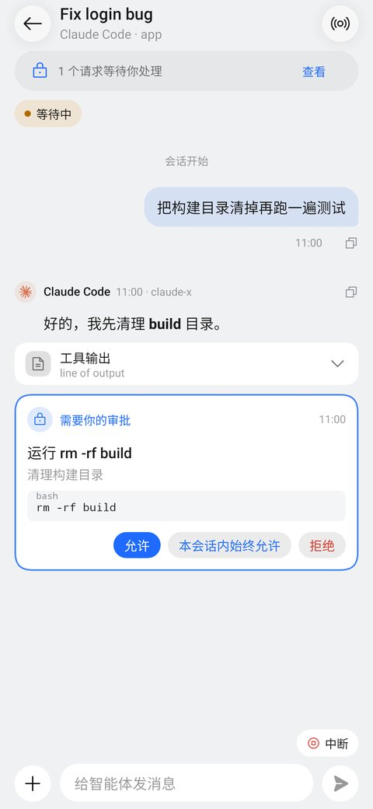
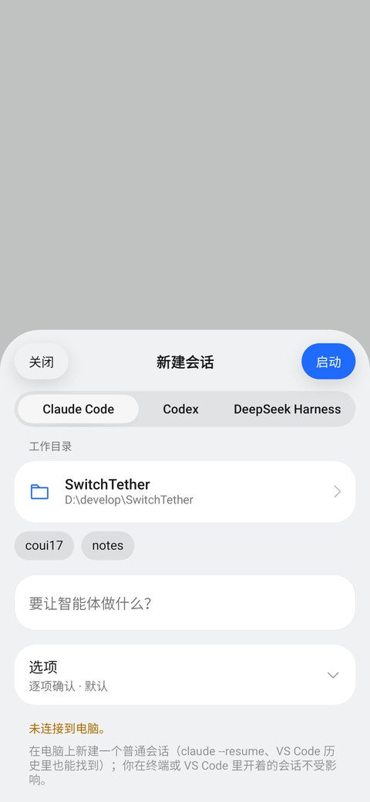
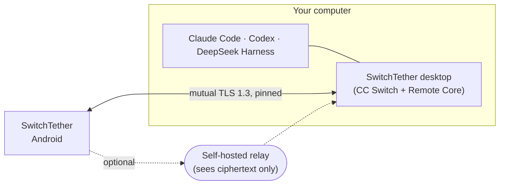

&nbsp;&nbsp;&nbsp;&nbsp;

# SwitchTether

**Your coding agents, in your pocket — still running on your own computer.**

Follow, steer and approve Claude Code, Codex and DeepSeek Harness from your phone,
and manage everything CC Switch manages. No cloud account, no changed workflow.

[**Download**](https://github.com/TIANLI0/SwitchTether/releases/latest) ·
[Quick start](#quick-start) ·
[FAQ](#faq) ·
[简体中文](README_ZH.md)

 

&nbsp;

&nbsp;

Screens rendered from the app's UI tests with sample data.

---

## Why SwitchTether

You started a long task, stepped away — and the agent is now waiting for a "yes" to run one
command. SwitchTether puts that session on your phone: you see what it did, approve or answer
in one tap, and keep it going from anywhere. The agents keep running on your computer, with your
settings, plugins, MCP servers and hooks, exactly as you set them up.

## Features

**💬 Sessions, natively**
- Live and past sessions of **Claude Code, Codex and DeepSeek Harness**: Markdown, code,
  thinking, tool calls with tappable files, diffs, plans, sub-agents and background tasks.
- Approvals and questions as cards you answer in one tap; notifications and Android Live Updates
  when something needs you or a task finishes.
- Sessions you start from the phone are named automatically, the way the agents' own apps do it.

**🚀 Start and steer from the phone**
- New sessions in any project folder; send text and pictures, interrupt, switch model, thinking
  effort and permission mode, run slash commands.
- **Opt-in takeover** of windows you opened yourself: the VS Code Claude panel, Codex Desktop,
  terminal sessions started with `st-claude` / `st-codex`, and `dsh web`. Off by default, backed
  up first, removed exactly when turned off.
- **DeepSeek Harness Web**: DSH's own web UI, full screen on the phone, through the same connection.

**🔐 Private by design**
- Pair once with a QR code. Direct connection over LAN, Tailscale or any address — or an optional
  [self-hosted relay](docs/RELAY.md) that only ever sees end-to-end TLS 1.3 ciphertext.
- Mutual certificates and pinning; keys in the Android Keystore and the OS keychain; revoke any
  phone instantly; terminals and risky actions need your fingerprint.

**🧰 A workspace in your pocket**
- Remote terminals, files with conflict-safe editing, upload and download, Git status / diff /
  history and a review of what the last turn changed, port forwarding.

**📊 CC Switch on the go**
- Switch and test providers, update keys write-only, usage and cost with an activity heatmap,
  remaining subscription quota on the home screen, MCP servers, skills and prompts.

## How it works

The desktop app is CC Switch with a remote core built in. It reads the agents' own session files,
starts new sessions through their official interfaces, and serves the phone over an authenticated
connection. It never edits your agent configuration to gain control and never restarts or injects
into processes you started.

## Supported agents

| Agent | Watch (history + live) | Control a session you started | New session from the phone |
|---|:---:|---|---|
| Claude Code CLI | ✅ | Opt-in: `st-claude` (mirrored terminal) | ✅ verified |
| Claude Code for VS Code | ✅ | Opt-in: VS Code hook | ✅ verified |
| Codex CLI | ✅ | Opt-in: `st-codex` | ✅ verified live |
| Codex Desktop | ✅ | Opt-in: Codex Desktop hook | ✅ verified live |
| DeepSeek Harness | ✅ | Opt-in: `dsh web` plugin · DSH Web on the phone | ⚠️ ACP, partial |

Without the opt-in hooks, sessions you started yourself are read-only — the agents offer no
supported way for another program to control a running session. Every claim above is backed by
evidence in [AGENT_COMPATIBILITY](docs/AGENT_COMPATIBILITY.md).

## Quick start

1. **Install** the desktop app (Windows, macOS, Linux) and the Android APK (Android 15+) from the
   [latest release](https://github.com/TIANLI0/SwitchTether/releases/latest).
2. **On the computer:** Settings → **Remote (phone)** → turn it on → **Show QR code**.
3. **On the phone:** **Pair a computer** → scan → check that both screens show the same 6-digit code.

Done. Your sessions appear on the phone; tap one to follow it, or start a new one.

> **macOS:** the dmg is a universal build (Apple Silicon and Intel) with an ad-hoc signature, not
> notarized. The first time, open it from Finder with right-click → **Open** (or System Settings →
> Privacy & Security → **Open Anyway**). If macOS still calls it damaged, run
> `xattr -dr com.apple.quarantine /Applications/SwitchTether.app` once.

> On first launch SwitchTether copies your CC Switch data from `~/.cc-switch` into its own
> `~/.switchtether`. CC Switch itself is never modified. Both apps write the same agent
> configuration, so manage providers in one of them.

## FAQ

<b>Does it change how I run Claude Code or Codex?</b>

No. You keep starting them exactly as before. SwitchTether reads their session files and starts
*additional* sessions through their official interfaces. The only thing that touches your agent
setup is the opt-in takeover, and only while you have it switched on.

<b>Does my code go through a server?</b>

No. Phone and computer talk directly. If you choose to use the relay, you host it yourself and it
only forwards encrypted bytes — it cannot read requests, files, terminals or keys.

<b>Why can't the phone control a session I started in my terminal?</b>

Because the agents don't provide a supported way to do that, and SwitchTether won't hack around
it. Turn on the takeover for that client (Settings → Remote), or start the session from the phone.

<b>Is the phone app on Google Play?</b>

Not yet. Install the signed APK from Releases; the app updates itself and verifies every
download against the release's `SHA256SUMS.txt`. No Google Play services required.

<b>Is it safe to open a terminal from the phone?</b>

A remote terminal has your full user rights, so it always asks for your fingerprint, and any
paired phone can be revoked from the desktop at once. See [SECURITY](docs/SECURITY.md).

## Documentation

[Architecture](docs/ARCHITECTURE.md) · [Protocol](docs/PROTOCOL.md) ·
[Agent compatibility](docs/AGENT_COMPATIBILITY.md) · [Relay](docs/RELAY.md) ·
[Security](docs/SECURITY.md) · [Android UI](docs/ANDROID_UI.md) · [Build](docs/BUILD.md) ·
[Testing](docs/TESTING.md) · [Upstream sync](docs/UPSTREAM_SYNC.md) ·
[Known limitations](docs/KNOWN_LIMITATIONS.md) · [Development status](docs/DEVELOPMENT_STATUS.md)

## Contributing

Issues and pull requests are welcome. Read [AGENTS.md](AGENTS.md) first — it lists the hard rules
(never take control by editing a user's agent setup, never return secrets, never claim what wasn't
verified) and the checks to run before committing.

## Credits and license

SwitchTether is [MIT-licensed](LICENSE). It is a fork of
[CC Switch](https://github.com/farion1231/cc-switch) by Jason Young (MIT), whose icon the desktop
app keeps; the original README is [README_UPSTREAM.md](README_UPSTREAM.md). The Android UI is
built on [COUI17](https://github.com/TIANLI0/COUI17) (Apache-2.0, with MPL-2.0 files), a
downstream of [coui17](https://github.com/Costben/coui17).

SwitchTether is not affiliated with Anthropic, OpenAI, DeepSeek, OPPO or the CC Switch authors.
