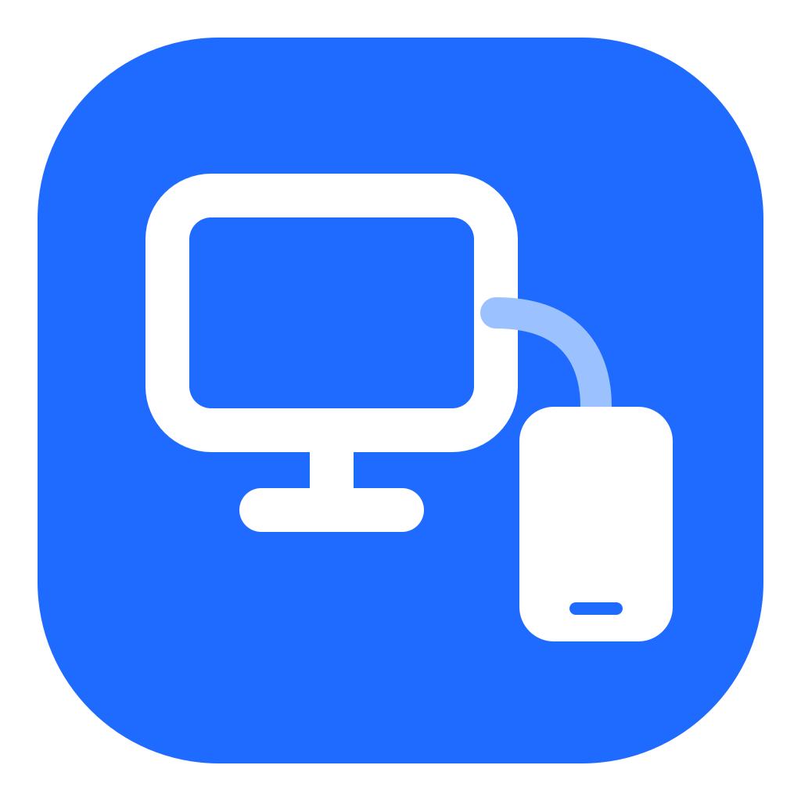

  

# SwitchTether

[English](README.md) | 简体中文 | [上游更新日志](CHANGELOG.md)

SwitchTether 是基于 [CC Switch](https://github.com/farion1231/cc-switch) 构建的原生 Android
伴侣与远程控制系统。它让你在不改变 Claude Code、Codex 启动方式的前提下，用手机查看、管理并与
自己电脑上运行的 AI 编程 Agent 交互，同时把手机变成完整的 CC Switch 移动管理客户端。

> **项目状态：预发布（0.1.0）。** 使用前请阅读 [docs/DEVELOPMENT_STATUS.md](docs/DEVELOPMENT_STATUS.md)
> 与 [docs/KNOWN_LIMITATIONS.md](docs/KNOWN_LIMITATIONS.md)。

## 功能

- **安全配对，无需云端。** 扫一次二维码即可。手机与电脑通过局域网、你自己的 Tailscale 网络或手动地址
  直连，使用 TLS 1.3、双向证书认证与证书固定。密钥保存在 Android Keystore 与桌面系统钥匙串中，任意手机
  都可以立即撤销。
- **Agent 会话。** 原生渲染 Claude Code / Codex 的实时与历史会话：消息、Markdown、代码、思考过程、
  工具调用、Diff、计划、提问与审批。
- **在合法可行的范围内完全控制。** 在手机上新建由 SwitchTether 管理的 Claude Code 或 Codex 会话
  （沿用你原有的设置、插件、Skills、MCP 与 Hooks），可以发送消息、审批工具调用、回答提问与中断。
- **如实标注兼容性。** 你自己在终端、VS Code 或 Codex Desktop 中启动的会话只读展示：上游工具没有提供
  允许其他程序控制运行中会话的受支持接口。详见 [docs/AGENT_COMPATIBILITY.md](docs/AGENT_COMPATIBILITY.md)。
- **远程终端。** 从手机在电脑上打开 PowerShell、CMD、bash 或 zsh（需要生物识别确认）。手机断开后
  Shell 继续运行。
- **文件与 Git。** 浏览、搜索、查看与编辑文件并检测冲突（绝不静默覆盖 IDE 已保存的内容），上传下载，
  查看 Git 状态、Diff 与历史。
- **CC Switch 管理。** 供应商（切换、测试、只写方式更新密钥）、用量与费用、订阅额度、MCP、Skills、
  提示词、代理状态。

## 兼容性概览

| 客户端 | 观察（历史 + 实时） | 控制其自身启动的会话 | 通过新建托管会话控制 |
|---|---|---|---|
| Claude Code CLI | 支持 | 上游不支持（BLOCKED） | 支持（已验证） |
| Claude Code VS Code 扩展 | 支持 | 上游不支持（BLOCKED） | 支持（已验证） |
| Codex CLI | 支持（rollout） | 上游不支持（BLOCKED） | 已实现，部分验证 |
| Codex Desktop | 支持（rollout） | 上游不支持（BLOCKED） | 已实现，部分验证 |

## 安装

### 桌面端（Windows、macOS、Linux）

从 [Releases](https://github.com/TIANLI0/SwitchTether/releases) 下载安装包，或自行构建
（[docs/BUILD.md](docs/BUILD.md)）。首次启动时 SwitchTether 会把 `~/.cc-switch` 中已有的 CC Switch
数据复制到自己的 `~/.switchtether` 目录，原 CC Switch 安装不会被修改。请只在其中一个应用里管理供应商
——两者写入同一批 Agent 配置文件。

### Android（10 及以上）

从 Releases 页面安装 APK（或 `android/app/build/outputs/apk/`）。不依赖 Google Play 服务。

## 配对与使用

1. 电脑：**设置 → 远程（手机）** → 启用远程访问 → 选择允许的网络（默认局域网 + Tailscale）→
   **显示二维码**。
2. 手机：打开 SwitchTether → **配对电脑** → 扫描二维码（或粘贴链接），核对两边显示的 6 位验证码。
3. 浏览会话、新建托管会话、打开终端或管理供应商。电脑端的 **已配对的手机** 列表列出所有设备，
   **撤销** 会立即断开该设备。

真正退出 SwitchTether 会结束它管理的远程终端和托管会话（退出前会提示）；关闭窗口则继续在托盘运行。
你自己启动的 Agent 不受影响。

## 安全

威胁模型、配对、二次（生物识别）认证、撤销、脱敏与安全测试清单见 [docs/SECURITY.md](docs/SECURITY.md)。
远程 Shell 拥有你在电脑上的全部用户权限，请妥善保护手机。

## 文档

| 文档 | 内容 |
|---|---|
| [ARCHITECTURE](docs/ARCHITECTURE.md) | 组件、数据流、设计决策 |
| [PROTOCOL](docs/PROTOCOL.md) | Remote API v1、事件流、Agent 事件结构 |
| [AGENT_COMPATIBILITY](docs/AGENT_COMPATIBILITY.md) | 已验证 / 部分 / 受阻能力及证据 |
| [ANDROID_UI](docs/ANDROID_UI.md) | Android 架构与渲染组件覆盖 |
| [BUILD](docs/BUILD.md) / [TESTING](docs/TESTING.md) | 构建、签名、测试 |
| [UPSTREAM_SYNC](docs/UPSTREAM_SYNC.md) | 如何合并 CC Switch 上游版本 |
| [KNOWN_LIMITATIONS](docs/KNOWN_LIMITATIONS.md) | 实际限制 |
| [research/](docs/research) | Agent 运行时调研证据 |

## 致谢与许可证

SwitchTether 采用 MIT 许可证（[LICENSE](LICENSE)），是 Jason Young 的
[CC Switch](https://github.com/farion1231/cc-switch)（MIT）的分支；原 README 保留为
[README_UPSTREAM.md](README_UPSTREAM.md)。Android 界面使用 [coui17](https://github.com/Costben/coui17)
（Apache-2.0，含 MPL-2.0 文件），以固定提交的形式收录于 `android/third_party/coui17`。SwitchTether 与
Anthropic、OpenAI、OPPO 及 CC Switch 作者均无关联。
