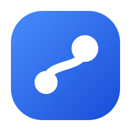
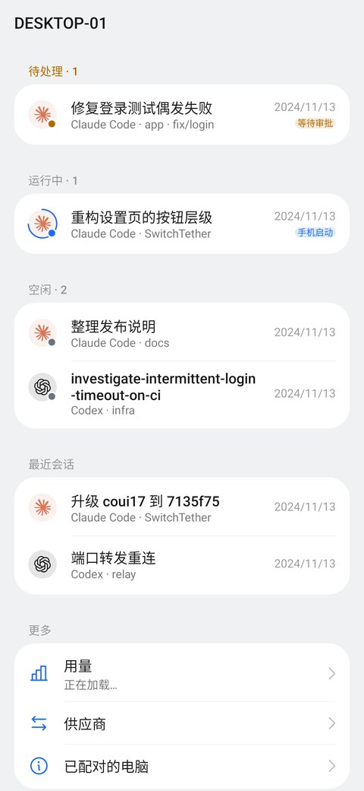
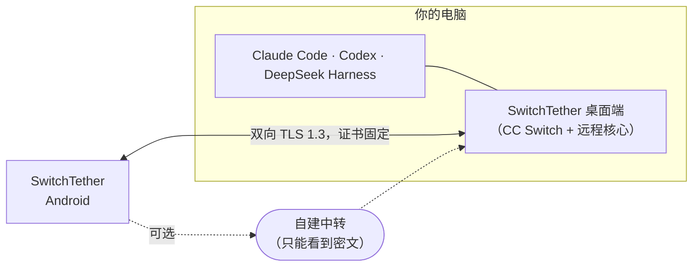

&nbsp;&nbsp;&nbsp;&nbsp;

# SwitchTether

**把编程 Agent 装进口袋——它们依然跑在你自己的电脑上。**

在手机上查看、操作和审批 Claude Code、Codex 与 DeepSeek Harness，
并管理 CC Switch 能管理的一切。不需要云端账号，不改变你的使用习惯。

[**下载**](https://github.com/TIANLI0/SwitchTether/releases/latest) ·
[快速开始](#快速开始) ·
[常见问题](#常见问题) ·
[English](README.md)

 

&nbsp;

&nbsp;

截图来自应用的界面测试，使用的是示例数据。

---

## 为什么需要 SwitchTether

你让 Agent 跑一个长任务，自己走开了——结果它卡在一条命令上，等你点一下"允许"。SwitchTether
把这个会话放到你的手机上：看得到它做了什么，一下就能审批或回答，在哪儿都能让它继续。Agent
依然跑在你的电脑上，沿用你原有的设置、插件、MCP 服务器和 Hooks。

## 功能

**💬 原生会话体验**
- **Claude Code、Codex、DeepSeek Harness** 的实时与历史会话：Markdown、代码、思考过程、可点开
  文件的工具调用、Diff、计划、子 agent 和后台任务。
- 审批和提问以卡片呈现，一下就能处理；需要你操作或任务完成时，会推送通知和 Android 实时活动
  （Live Updates）。
- 从手机发起的会话会自动起标题，做法和各 Agent 官方客户端一致。

**🚀 在手机上新建和操作会话**
- 在任意项目文件夹新建会话；发文字和图片、中断，切换模型、思考强度和权限模式，使用斜杠命令。
- **接管**你自己打开的窗口：VS Code 的 Claude 面板、Codex Desktop、用 `st-claude` /
  `st-codex` 启动的终端会话，以及 `dsh web`。首次运行时默认开启一次（先备份，不替换你自己设置的值）；
  关掉的开关会一直保持关闭，关闭时原样移除。
- **DeepSeek Harness 网页版**：在手机上全屏打开 DSH 自己的网页界面，走同一条连接。

**🔐 隐私优先**
- 扫一次二维码完成配对。通过局域网、Tailscale 或任意地址直连，也可以用可选的
  [自建中转](docs/RELAY.md)，中转只能看到端到端的 TLS 1.3 密文。
- 双向证书 + 证书固定；密钥保存在 Android Keystore 和系统钥匙串；任何手机都能随时撤销；
  终端和高风险操作需要指纹确认。

**🧰 随身工作区**
- 远程终端、带冲突检测的文件编辑、上传下载、Git 状态 / Diff / 历史和本轮改动审查、端口转发。

**📊 随身 CC Switch**
- 切换和测试供应商、只写方式更新密钥、用量与费用（含活跃热力图）、首页显示订阅剩余额度、
  MCP 服务器、Skills 和提示词。

## 工作原理

桌面端就是内置了远程核心的 CC Switch。它读取各 Agent 自己的会话文件，通过官方接口启动新会话，
并在经过认证的连接上为手机提供服务。它不会为了获得控制权去修改你的 Agent 配置，也不会重启或
注入你自己启动的进程。

## 支持的 Agent

| Agent | 查看（历史 + 实时） | 控制你自己启动的会话 | 从手机新建会话 |
|---|:---:|---|---|
| Claude Code CLI | ✅ | 接管：`st-claude`（终端镜像） | ✅ 已验证 |
| Claude Code VS Code 扩展 | ✅ | 接管：VS Code | ✅ 已验证 |
| Codex CLI | ✅ | 接管：`st-codex` | ✅ 已实测 |
| Codex Desktop | ✅ | 接管：Codex Desktop | ✅ 已实测 |
| DeepSeek Harness | ✅ | 接管：`dsh web` 插件 · 手机上用 DSH 网页版 | ⚠️ ACP，部分验证 |

不开启接管时，你自己启动的会话只读——这些 Agent 没有提供让其他程序控制运行中会话的受支持接口。
上表每一项都有证据，见 [AGENT_COMPATIBILITY](docs/AGENT_COMPATIBILITY.md)。

## 快速开始

1. **安装**：从[最新版本](https://github.com/TIANLI0/SwitchTether/releases/latest)下载桌面端
   （Windows、macOS、Linux）和 Android APK（Android 15 及以上）。
2. **电脑端**：点工具栏上的 **远程**（默认已开启）→ **显示二维码**。
3. **手机端**：**配对电脑** → 扫码 → 确认两边显示的 6 位验证码一致。

完成。你的会话会出现在手机上，点开就能跟进，也可以直接新建一个。

> **macOS：** dmg 是通用版本（Apple Silicon 和 Intel 都能用），只做了 ad-hoc 签名，没有经过公证。
> 第一次打开时请在访达里右键 → **打开**（或到 系统设置 → 隐私与安全性 → **仍要打开**）。
> 如果仍提示"已损坏"，执行一次 `xattr -dr com.apple.quarantine /Applications/SwitchTether.app`。

> 首次启动时，SwitchTether 会把 `~/.cc-switch` 里的 CC Switch 数据复制到自己的
> `~/.switchtether`，不会修改 CC Switch 本身。两个应用写入同一份 Agent 配置，请只用其中一个管理供应商。

## 常见问题

<b>会改变我运行 Claude Code 或 Codex 的方式吗？</b>

不会。你照常启动它们。SwitchTether 读取它们的会话文件，并通过官方接口启动*额外*的会话。唯一会
碰到你 Agent 配置的是接管，而且只在它开启期间生效（默认开启；在设置 → 远程里关掉后保持关闭）。

<b>我的代码会经过服务器吗？</b>

不会。手机和电脑直接通信。如果你选择用中转，它由你自己部署，只转发加密后的数据，看不到请求、
文件、终端内容或密钥。

<b>为什么手机不能控制我在终端里开的会话？</b>

因为这些 Agent 没有提供受支持的方式，SwitchTether 也不会用旁门左道去绕。可以在设置 → 远程里为
对应客户端开启接管，或者直接从手机新建会话。

<b>手机端上架 Google Play 了吗？</b>

还没有。请从 Releases 安装正式签名的 APK；应用会自动检查更新，并用发布附带的 `SHA256SUMS.txt`
校验每次下载。不需要 Google Play 服务。

<b>在手机上开终端安全吗？</b>

远程终端拥有你完整的用户权限，所以每次都需要指纹确认，任何已配对手机都能在电脑端立即撤销。
详见 [SECURITY](docs/SECURITY.md)。

## 文档

[架构](docs/ARCHITECTURE.md) · [协议](docs/PROTOCOL.md) ·
[Agent 兼容性](docs/AGENT_COMPATIBILITY.md) · [中转](docs/RELAY.md) ·
[安全](docs/SECURITY.md) · [Android 界面](docs/ANDROID_UI.md) · [构建](docs/BUILD.md) ·
[测试](docs/TESTING.md) · [上游同步](docs/UPSTREAM_SYNC.md) ·
[已知限制](docs/KNOWN_LIMITATIONS.md) · [开发状态](docs/DEVELOPMENT_STATUS.md)

## 参与贡献

欢迎提 Issue 和 Pull Request。请先阅读 [AGENTS.md](AGENTS.md)：里面列出了硬性规则（不得通过修改
用户的 Agent 配置来获取控制权、不得返回密钥、不得宣称未经验证的结果）以及提交前要跑的检查。

## 致谢与许可

SwitchTether 以 [MIT 协议](LICENSE)发布。它分叉自 Jason Young 的
[CC Switch](https://github.com/farion1231/cc-switch)（MIT），桌面端沿用了 CC Switch 的图标；原始
README 保留为 [README_UPSTREAM.md](README_UPSTREAM.md)。Android 界面基于
[COUI17](https://github.com/TIANLI0/COUI17)（Apache-2.0，部分文件 MPL-2.0），它是
[coui17](https://github.com/Costben/coui17) 的下游。

SwitchTether 与 Anthropic、OpenAI、DeepSeek、OPPO 及 CC Switch 作者均无关联。
